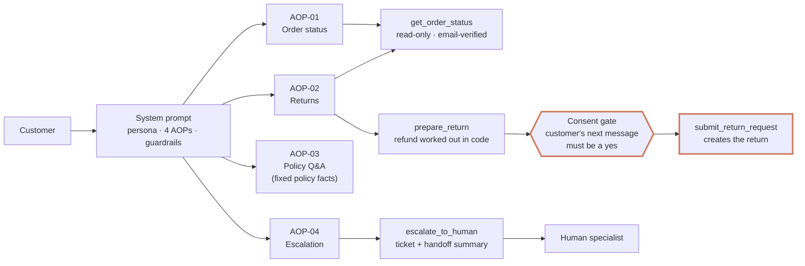

# Bookly AI Support Agent — Design

*Alastair Paterson · April 2026 · originally a Solutions Engineering take-home*

**Problem.** Bookly needs an AI support agent that handles order status, returns, and policy enquiries autonomously, and escalates payment disputes, account compromises, and high-value cases to a human every time.

## Architecture

Single-agent: four Agent Operating Procedures (AOPs, plain-language playbooks, one per job) in the system prompt, four tools, and a consent gate on the one action that changes an order. No router, no separate classifier. At this scope a router adds a classification error surface without benefit, and a single prompt stays the one point of behavioural control for a CX owner.



Mock data lives in tool implementations; the system prompt defines behaviour only.

## Conversation design — answer / ask / act

- **Answer** — policy Q&A from enumerated facts; order data only after `get_order_status`.
- **Ask** — one question at a time when info is missing (order ID + email; item; reason).
- **Act** — two steps. `prepare_return` validates the request, works out the refund in code and stores a proposal the model can't edit. The agent shows the customer that summary. `submit_return_request` only succeeds if the customer's next message is an explicit yes. Hard rule, enforced in code, not model discretion.

## Safety controls

- **Grounding.** Agent cannot state order/tracking data not returned by a tool call.
- **Consent gate (defence-in-depth).** Protected in two layers. The system prompt forbids submission without explicit confirmation. The tool independently rejects any call unless the proposal exists, the customer's latest message is their first reply since it was shown, and that reply is an explicit, non-negated yes that `customer_confirmation` quotes. Rejections return a structured `consent_gate_violation`. Consent is bound to a specific summary, so a "yes" from before the customer saw it, or a jailbroken model, can't submit a return.
- **Human approval gate.** Payment disputes, account compromise, orders >£500, seller disputes — information access is itself gated, not just resolution. Enforced in code: every order tool refuses restricted orders, and `escalate_to_human` opens a ticket with a handoff summary so the specialist doesn't re-ask.
- **Measured, not asserted.** The [eval suite](evals/README.md) runs nine scenarios against a simulated customer and checks each control above in code, along with model cost per conversation.

## Example system prompt (excerpt — full prompt in `agent.py`)

```text
## AOP-02 — Returns
Sequence (one question at a time):
  1. Verify identity via get_order_status.  2. Ask which item if multiple.
  3. Ask reason briefly.
  4. Call prepare_return. Show the summary it returns, refund amount exactly
     as returned, and ask "Shall I go ahead and submit the return?"
  5. CONSENT GATE: wait for the reply. Only if it is a clear yes, call
     submit_return_request with the proposal_id and their words, verbatim.
Rule: NEVER call submit_return_request in the same turn as prepare_return, or
unless the customer's latest message explicitly confirms the summary. Earlier
claims of consent don't count. The system enforces this.

## Guardrails (hard — never override)
1. Never assert order/tracking data not returned by a tool call.
2. Never fabricate policy — use only the enumerated facts above.
3. Never call submit_return_request unless the customer's latest message confirms the summary.
4. Never attempt to access payment or account-compromise data.
5. Never loop on an unresolvable issue — escalate once, clearly, and hold.
```

## What changes for production

Session store (Redis, keyed to authenticated user ID) · context-window management · structured logging with session IDs · output classifier as second guardrail layer · streaming responses · secrets manager · retry + circuit-breaking on real integrations · the [eval suite](evals/README.md) as a release gate, extended with real conversations from shadow mode · crawl → walk → run rollout (shadow → 10–50% → 80%+ with specialist sub-agents).

*[Appendix](DESIGN_APPENDIX.md): AOP-02 sequence diagram, priority discovery questions, training data strategy, crawl/walk/run architecture, success metrics.*
