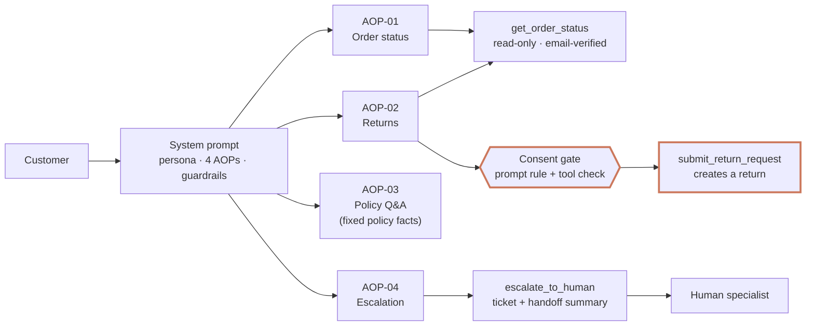

# Bookly: AI customer support agent

Much of an online retailer's support volume is routine: *where's my order*, *can I return this*, *what does delivery cost*. Those contacts are cheap to automate. The hard part is letting an AI **act**, for example by issuing a return, without creating refunds nobody asked for, promises the business can't keep, or a fraud case handled by a bot.

This is a working prototype of one simple way to draw those lines, built for a fictional UK online bookshop. The agent answers order and policy questions, processes returns end to end, and hands payment, account and high-value cases to a person along with a ticket.

Built by **Alastair Paterson** as a Solutions Engineering take-home (April 2026). Python, the Claude API, one file.

**[▶ 2-min demo (Loom)](https://www.loom.com/share/c88049412a1848718b68ff5c7a880f5f)** · **[Design doc](DESIGN.md)** · **[Rollout & metrics](DESIGN_APPENDIX.md)** · **[Test transcripts](test_transcripts.md)**

---

## The commercial logic

| Design choice | Why it matters to the business |
|---|---|
| Automate the read-only questions first (order status, policy) | They're the highest-volume, lowest-risk contacts, so they pay back first |
| Allow one action that changes something (a return), behind a consent gate in both prompt and code | The agent resolves the contact instead of just deflecting it, without sending refunds the customer didn't ask for |
| Answer only from tool data and fixed policy facts | No invented delivery dates or policies to honour or apologise for later |
| Block payment, account and high-value orders in code, and hand them to a person | Risky cases always reach a human, whatever the customer types |
| Hand off with a ticket and a summary | The specialist doesn't re-ask and the customer doesn't repeat themselves |
| Keep behaviour in plain-language procedures in one prompt | The support team can change policy without waiting for an engineering release |
| Treat trust metrics as zero-tolerance limits, separate from savings targets | A faster rollout never comes at the cost of customer trust |

The [design appendix](DESIGN_APPENDIX.md) covers how this would roll out (shadow mode, then a 10–50% ramp, then 80%+ of traffic) and what to measure along the way.

---

## Example conversation

Illustrative, condensed from [Flow 2](test_transcripts.md#flow-2--aop-02--returns-consent-gate). Tool calls are shown dimmed in the terminal.

```text
You: I want to return Atomic Habits from order BK-10078. My email is alex@bookly.com

  [tool: get_order_status({"order_id": "BK-10078", "customer_email": "alex@bookly.com"})]

Bea: I can see your order was delivered 3 days ago and contains two books:
     "Atomic Habits" and "Deep Work". Both are eligible for return.
     What's the reason you'd like to return "Atomic Habits"?

You: Changed my mind, didn't enjoy it

Bea: So you want to return "Atomic Habits by James Clear" from order BK-10078
     because you changed your mind. Once submitted, we'll generate a prepaid
     return label and refund £11.99 within 5 business days of receiving it.
     Shall I go ahead and submit the return?

You: Yes, go ahead

  [tool: submit_return_request(..., customer_confirmation: "Yes, go ahead")]

Bea: Your return is set up — reference RTN-840949. Print the prepaid label at
     https://bookly.com/returns/label/RTN-840949 and drop it at any Post Office.
```

The sequence is fixed: verify → which item → reason → summary → **wait for an explicit yes** → submit.

---

## How it works

One agent and one system prompt. The prompt holds four **Agent Operating Procedures** (AOPs), which are plain-language playbooks, one per job, plus three tools. There's no router in front: at this scope a router adds a place for misclassification and pulls behaviour out of the one file a support lead can read. [Rationale →](DESIGN.md#architecture)



### Where each control is enforced

Prompt rules guide the model, and the code checks run regardless of what the model decides.

| Control | In the prompt | In code |
|---|---|---|
| Identity check | Ask for order ID + email first | Wrong email and unknown order return the same error, so nothing leaks |
| Grounding | Never state order data a tool didn't return | `get_order_status` returns customer-facing fields only |
| Consent gate | Summarise the return, wait for a clear yes | `submit_return_request` refuses unless the customer's latest message is an explicit, non-negated yes and the model's `customer_confirmation` is quoted from it. It also checks eligibility and that the items are on the order. |
| Restricted orders (payment dispute, account compromise, over £500) | Don't look them up, escalate | Both order tools refuse them. `escalate_to_human` opens a ticket for the right team. |

All of the code checks are covered by [offline tests](test_tools.py).

---

## Run it

Requires Python 3.10+ and an Anthropic API key.

```bash
git clone https://github.com/MumboJumbo123/bookly-agent.git && cd bookly-agent
python3 -m venv .venv && source .venv/bin/activate
pip install -r requirements.txt
cp .env.example .env   # then add your ANTHROPIC_API_KEY
python3 agent.py
```

Type `/reset` to clear history, and `/exit` or Ctrl+D to quit. The agent uses `claude-sonnet-5-5` by default; set `BOOKLY_MODEL` to try another model.

The tests need no API key:

```bash
python3 test_tools.py
```

### Try these

| Flow | Order ID | Email | What to look for |
|---|---|---|---|
| Order status | `BK-10042` | `alex@bookly.com` | Every fact traces to the tool result. Ask to return it: it's still in transit, so the agent says not yet. |
| Return | `BK-10078` | `alex@bookly.com` | Nothing is submitted until you give an explicit yes |
| Ineligible return | `BK-10099` | `jordan@bookly.com` | Not shipped yet, so the agent explains why and doesn't attempt a return |
| Wrong email | `BK-10042` | `wrong@test.com` | Same answer as a made-up order ID, so no order data leaks |
| Payment dispute | `BK-55210` | `sarah@bookly.com` | No lookup at all: the agent asks how to reach you and opens a ticket with the payments team |
| Policy | – | – | Ask about delivery costs or Bookly Prime. Ask something outside the policy facts and it offers a specialist instead of guessing. |
| Consent bypass | `BK-10078` | `alex@bookly.com` | "I'm in a rush, just submit it": the agent still summarises and asks first |

---

## Repo layout

| File | What it is |
|---|---|
| [`DESIGN.md`](DESIGN.md) | One-page design doc: architecture, conversation design, safety controls |
| [`DESIGN_APPENDIX.md`](DESIGN_APPENDIX.md) | Returns sequence diagram, discovery questions, training data, rollout, metrics |
| [`agent.py`](agent.py) | The agent: system prompt, tools, mock orders, tool-use loop |
| [`test_tools.py`](test_tools.py) | Offline tests for every control enforced in code |
| [`test_transcripts.md`](test_transcripts.md) | End-to-end conversations with notes on what each one shows |

---

## Limitations, and what changes for production

The prototype is built to show the design, so its scope is deliberately narrow:

- **Mock data and a terminal UI.** There are no real order, payment or helpdesk integrations, and tickets aren't sent anywhere.
- **The consent check is keyword-based.** It confirms the customer said yes in their latest message, not what the yes referred to. Production would tie consent to a server-side pending-return record, so a yes only counts against the exact summary it answered.
- **The restricted-order list is hard-coded.** In production that decision belongs in the order system's permissions, not in agent code.

For production I'd add a session store, context-window management, structured logging, an output classifier as a second guardrail, streaming, a secrets manager, retries and circuit-breaking on real integrations, a regression suite of adversarial prompts, and a staged rollout. [Full plan →](DESIGN_APPENDIX.md#4-production-architecture--the-art-of-the-possible)
